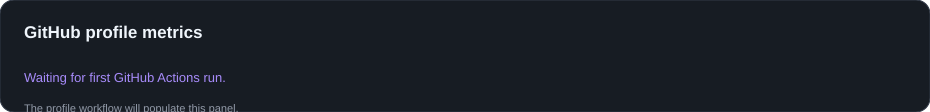
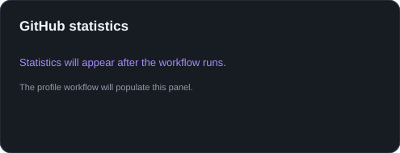
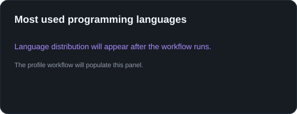
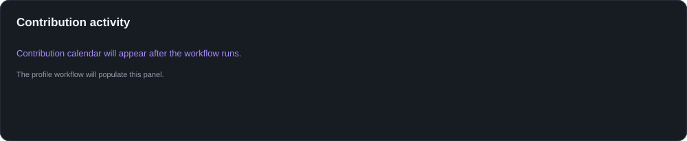

---

---

## ◈ Projects

---

## ⌘ Tools & Technologies

### Development

`Android Studio`　`Kotlin`　`Git`　`GitHub`　`Visual Studio Code`　`PowerShell`

### Engineering & Design

`Autodesk Revit`　`Structural Design`　`Surveying`　`Canva`

### Data & Productivity

`Microsoft Excel`　`Data Analytics`　`AI Tools`

---

## ⟡ GitHub Activity

<!-- Profile views use Komarev; the other activity panels are generated and hosted in this repository. -->

  

  

  

Repository-generated activity panels refresh hourly through GitHub Actions. GitHub may delay scheduled runs. Profile views use a separate visitor-counter service.

---

## ↗ Connect

