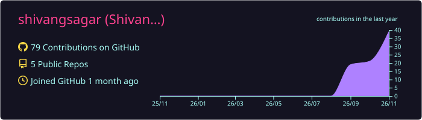
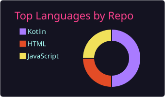
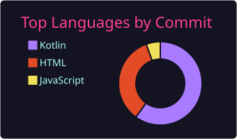
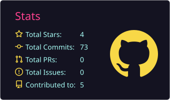
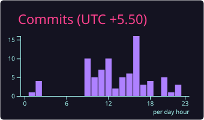

<h1 align="center">Hi, I'm Shivang Sagar 👋</h1>

  Civil Engineering Undergrad · Android &amp; Web Developer · Data Enthusiast

  
  

  
  

---

## 🚀 Projects

### [Presencia](https://github.com/shivangsagar/Presencia)
Sleek attendance tracker with interactive calendars, dynamic donut charts, and pure black/white themes.

### [LectureTracker](https://github.com/shivangsagar/LectureTracker)
Simple Android app for tracking lecture progress and completion percentage.

### [portfolio](https://github.com/shivangsagar/portfolio)
Personal portfolio showcasing my projects, technical work, skills, and experience across engineering and technology.

### [shivangsagar.github.io](https://github.com/shivangsagar/shivangsagar.github.io)
Personal website.

  

---

## 🛠️ Tools & Technologies

### Languages used in my repos

### Development

### Engineering & Design

### Data & Productivity

---

## 📊 GitHub Statistics

<!-- PROFILE DETAILS -->
### 👤 Profile Overview

  

<!-- STREAK STATS -->
### 🔥 Contribution Streak

  

<!-- LANGUAGE STATISTICS -->
### 💻 Programming Languages

<table>
  <tr>
    <td width="50%" align="center">
      <strong>Languages by Repository</strong>
        
      
    </td>
    <td width="50%" align="center">
      <strong>Top Languages by Commits</strong>
        
      
    </td>
  </tr>
</table>

<!-- GITHUB STATISTICS -->
### 🏆 GitHub Statistics

  

<!-- PRODUCTIVE TIME -->
### ⏰ Commit Activity by Time of Day

  

  Commit activity analysed in Indian Standard Time (UTC+05:30).

## 📈 Contribution Activity

  

---

  ⭐ Thanks for visiting! Feel free to explore my repositories and connect with me.

