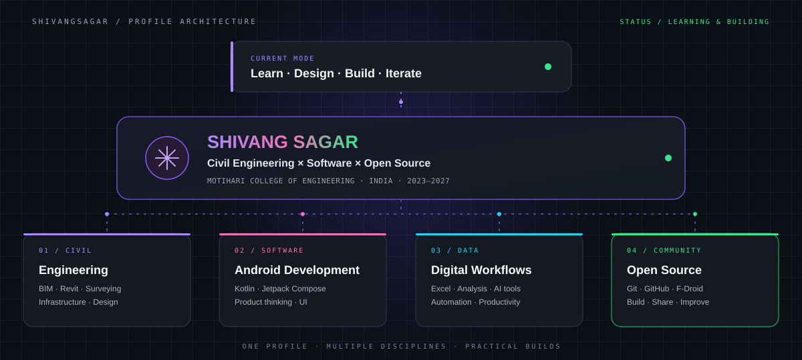
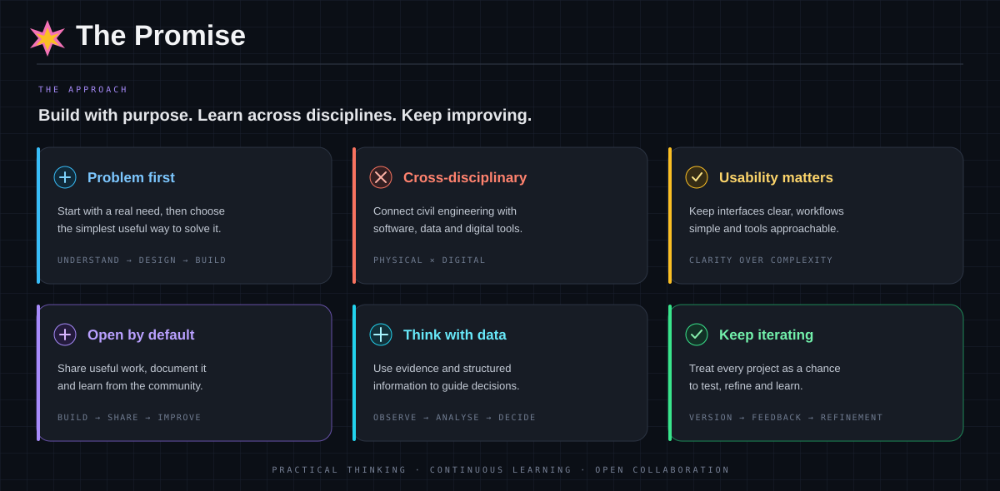
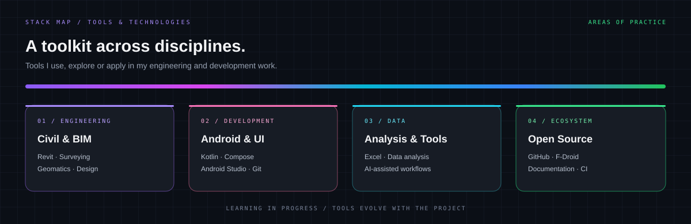

<!--
  SHIVANG SAGAR — GitHub Profile README
  Repository: https://github.com/shivangsagar/shivangsagar
  Theme: dark technical dashboard / neon accents
-->

<div align="center">



<p>
  <a href="https://www.linkedin.com/in/shivangsagar/">
    
  </a>
  <a href="https://github.com/shivangsagar">
    
  </a>
  <a href="https://github.com/shivangsagar?tab=repositories">
    
  </a>
</p>

<p>
  <code>CIVIL ENGINEERING</code> &nbsp;·&nbsp;
  <code>ANDROID DEVELOPMENT</code> &nbsp;·&nbsp;
  <code>OPEN SOURCE</code> &nbsp;·&nbsp;
  <code>DATA & DIGITAL TOOLS</code>
</p>

</div>

---

## `01` &nbsp; THE PROMISE



I am **Shivang Sagar**, a Civil Engineering undergraduate at **Motihari College of Engineering, Bihar** (2023–2027).

I am interested in the space where the physical and digital worlds meet: applying engineering fundamentals, software and data to make practical workflows simpler and more useful.

---

## `02` &nbsp; QUICK ACCESS

| AREA | GO TO |
|:--|:--|
| **Profile** | [About me](#03--about-me) · [Current focus](#04--current-focus) |
| **Work** | [Featured projects](#05--selected-work) · [Experience](#06--field--community) |
| **Toolkit** | [Tools and technologies](#07--toolkit) |
| **Activity** | [GitHub statistics](#08--github-activity) |
| **Contact** | [Connect](#09--connect) |

---

## `03` &nbsp; ABOUT ME

```text
ROLE       Civil Engineering Undergraduate
COLLEGE    Motihari College of Engineering, Bihar
BATCH      2023 — 2027
INTERESTS  Infrastructure · Software · Data · Open Source
```

My interests extend beyond conventional engineering coursework. I enjoy learning how digital tools can support engineering practice, and I build small applications to solve everyday problems.

My approach is simple: understand the problem, build a useful solution, test it, and improve it.

---

## `04` &nbsp; CURRENT FOCUS



| TRACK | EXPLORING |
|:--|:--|
| **Civil & BIM** | Structural engineering fundamentals, Autodesk Revit, BIM, surveying and geomatics |
| **Software** | Android development, Kotlin, Jetpack Compose, Git and GitHub |
| **Data** | Microsoft Excel, data analysis, AI-assisted workflows and digital documentation |
| **Open Source** | Building practical tools, maintaining repositories and improving project documentation |

---

## `05` &nbsp; SELECTED WORK

<div align="center">

`BUILT TO SOLVE SMALL, REAL-WORLD PROBLEMS`

</div>

<table>
  <tr>
    <td width="50%" valign="top">
      <h3>01 / Presencia</h3>
      <p>
        <a href="https://github.com/shivangsagar/Presencia"></a>
        <a href="https://github.com/shivangsagar/Presencia"></a>
      </p>
      <p>A minimal attendance-management Android application focused on a clean interface and locally stored data.</p>
      <p><strong>FEATURES</strong></p>
      <ul>
        <li>Attendance marking and management</li>
        <li>On-device data storage</li>
        <li>Donut-chart visualisation</li>
        <li>Light and dark themes</li>
      </ul>
      <p><strong>STACK</strong><br><code>Kotlin</code> <code>Android</code> <code>Jetpack Compose</code> <code>Gson</code></p>
      <p><a href="https://github.com/shivangsagar/Presencia">VIEW REPOSITORY →</a></p>
    </td>
    <td width="50%" valign="top">
      <h3>02 / LectureTracker</h3>
      <p>
        <a href="https://github.com/shivangsagar/LectureTracker"></a>
        <a href="https://github.com/shivangsagar/LectureTracker"></a>
      </p>
      <p>A minimal lecture-tracking project designed to help students keep track of academic activity.</p>
      <p><strong>FEATURES</strong></p>
      <ul>
        <li>Lecture tracking</li>
        <li>Donut-chart visualisation</li>
        <li>Minimal black-and-white interface</li>
        <li>Student-focused functionality</li>
      </ul>
      <p><strong>STACK</strong><br><code>Android Development</code> <code>Git</code> <code>GitHub</code></p>
      <p><a href="https://github.com/shivangsagar/LectureTracker">VIEW REPOSITORY →</a></p>
    </td>
  </tr>
</table>

<div align="center">

<a href="https://github.com/shivangsagar?tab=repositories"></a>

</div>

---

## `06` &nbsp; FIELD & COMMUNITY

| EXPERIENCE | DETAILS |
|:--|:--|
| **BRPNNL** | Civil Engineering internship · 29 October – 28 November 2026 |
| **NSS** | Volunteering and participation in college initiatives |
| **NPTEL** | Recognised among the toppers in a Humanities course |

I value practical exposure, collaboration and learning beyond the classroom. These experiences complement my interest in engineering, technology and problem-solving.

---

## `07` &nbsp; TOOLKIT

<p>
  <strong>DEVELOPMENT</strong><br>
  
  
  
  
  
  
  
  
</p>

<p>
  <strong>ENGINEERING & DESIGN</strong><br>
  
  
  
  
  
</p>

<p>
  <strong>DATA & PRODUCTIVITY</strong><br>
  
  
  
</p>

---

## `08` &nbsp; GITHUB ACTIVITY

<div align="center">

<a href="https://github.com/shivangsagar?tab=followers"></a>
<a href="https://github.com/shivangsagar/Presencia"></a>
<a href="https://github.com/shivangsagar/LectureTracker"></a>

<br><br>


<br>


<br>


</div>

[OPEN GITHUB CONTRIBUTION GRAPH →](https://github.com/shivangsagar?tab=overview)

---

## `09` &nbsp; CONNECT

<div align="center">

### IDEAS ARE BETTER WHEN BUILT TOGETHER.

Interested in civil engineering, software, open source or cross-disciplinary projects? Let's connect.

<br>

<a href="https://www.linkedin.com/in/shivangsagar/"></a>
<a href="https://github.com/shivangsagar"></a>

<br><br>

<code>ENGINEERING IDEAS / BUILDING TOOLS / LEARNING IN PUBLIC</code>

</div>
